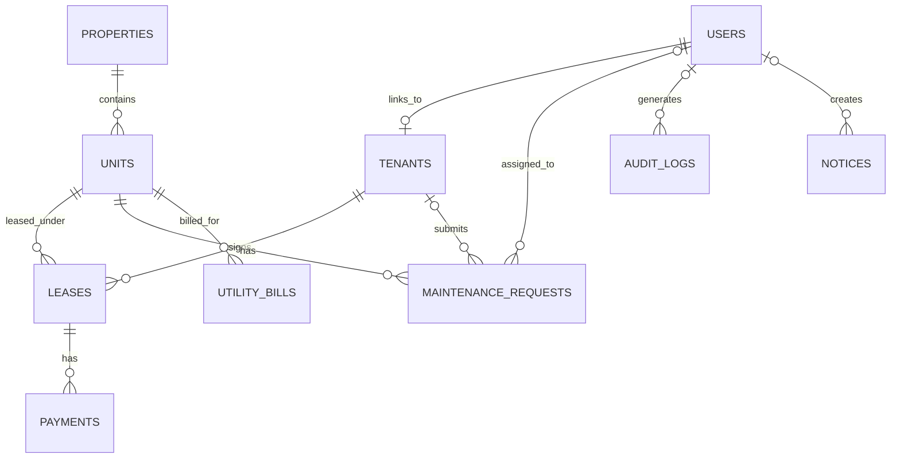

# Project Documentation — RentWise

## 1. System overview
RentWise is a web-based property rental and property management system for a company managing apartments, condominiums, commercial spaces, units, and tenant relationships. Its purpose is to centralize operational records and help authorized staff identify vacancies, lease expiry, unpaid rent, utility balances, and pending maintenance.

### Goals
1. Maintain structured property and unit records.
2. Record tenants, leases, payments, utility bills, and maintenance requests.
3. Help staff detect vacant/occupied units, overdue rent, unpaid utilities, and leases expiring within 30 days.
4. Enforce role-based access and tenant privacy.
5. Provide reports, audit records, and a tested backup/recovery procedure.

### User roles
- **Administrator:** technical account and audit oversight; broad administrative access.
- **Property Owner:** property portfolio oversight and authorized operational/financial access.
- **Property Manager:** property, unit, tenant, lease, maintenance, utility, and notice workflows.
- **Tenant:** should see their own lease/payment information and submit/track their own maintenance requests. In this prototype tenant-specific portal functionality is partial; maintenance listing is filtered to requests associated with the tenant's linked record.
- **Maintenance Staff:** should see assigned work only. The prototype filters maintenance rows to the current staff assignment.
- **Leasing Officer:** property/unit/tenant/lease records and notices.
- **Accountant:** payment and utility records and financial reports.

## 2. Modules and business rules
1. **Property management:** property name, address, and type.
2. **Unit management:** each unit belongs to a property; unit number must be unique within a property; rent cannot be negative; status is Vacant, Occupied, or Under Maintenance.
3. **Tenant registration:** tenant name and contact details. Tenant data is confidential.
4. **Lease management:** each lease refers to one unit and one tenant; end date must not precede start date; rent cannot be negative. Approved/signed lease records should not be casually deleted or edited. The prototype has status changes but does not yet implement signed contract files or immutable approvals.
5. **Rent collection:** each payment refers to a lease; amount must be greater than zero; statuses are Unpaid, Paid, and Overdue. A payment marked Paid receives today's paid date.
6. **Maintenance:** each request refers to a unit and may refer to a tenant; priority and workflow status are controlled values. Maintenance staff should access assigned requests only.
7. **Utility billing:** each utility bill refers to a unit and has a due date, amount, and status.
8. **Notices:** notices can be written for an audience.
9. **Reports:** unit occupancy and authorized financial summaries.
10. **Audit logs:** records successful/failed logins, logout, creates, and status changes. Administrator-only UI.

### Required detection logic
- Vacant/occupied units: derived from `units.status`.
- Expired/upcoming leases: compare `leases.end_date` and `leases.status` to today's date. Dashboard currently counts active leases expiring within 30 days; an automatic nightly status update is not yet implemented.
- Overdue rent: report counts `Overdue` payments and unpaid payments with a due date before today.
- Pending maintenance: count Pending, Assigned, and In Progress requests.
- Unpaid utilities: filter utility bills whose status is Unpaid or whose due date has passed. Automatic daily status conversion is a recommended extension.

## 3. Architecture
```text
User
  ↓
Browser (HTML/CSS/JavaScript, responsive interface)
  ↓ HTTPS in production
Flask Web Application / Application + JSON API Server
  ├── Authentication, session, authorization, validation, audit logging
  ├── Business rules and report queries
  ↓
SQLite relational database (local prototype; use managed PostgreSQL/MySQL for multi-user production)
  ↓
Encrypted off-host backup storage (operational policy)
```
The browser never connects directly to the database. Backend routes validate user identity and role before queries. SQL statements use parameter placeholders for values.

## 4. API documentation
All endpoints require an authenticated session. JSON responses are intended for browser/application use.

| Method | Endpoint | Purpose | Response |
|---|---|---|---|
| GET | `/api/summary` | Aggregate counts for units, vacancies, overdue payments, pending maintenance | JSON object |
| GET | `/api/units` | List unit records | JSON array |

Example:
```bash
curl -b cookies.txt http://127.0.0.1:5000/api/summary
```
The API currently exposes read-only endpoints. Future versions may add POST/PUT/DELETE endpoints with CSRF protection, strict schemas, role checks, and transaction boundaries.

## 5. Database and ERD
See `../schema.sql` for table definitions. Entity relationship outline:


### Relational schema (PK = primary key, FK = foreign key)
- `USERS(id PK, username UNIQUE, password_hash, role, full_name, active, created_at)`
- `PROPERTIES(id PK, name, address, property_type, created_at)`
- `UNITS(id PK, property_id FK, unit_number, bedrooms, monthly_rent, status, UNIQUE(property_id, unit_number))`
- `TENANTS(id PK, user_id FK nullable, full_name, email, phone, created_at)`
- `LEASES(id PK, unit_id FK, tenant_id FK, start_date, end_date, monthly_rent, status, approved_by FK nullable, created_at)`
- `PAYMENTS(id PK, lease_id FK, amount, due_date, paid_date, payment_method, reference_no, status, recorded_by FK nullable, created_at)`
- `MAINTENANCE_REQUESTS(id PK, unit_id FK, tenant_id FK nullable, title, description, priority, status, assigned_to FK nullable, created_at, completed_at)`
- `UTILITY_BILLS(id PK, unit_id FK, bill_type, amount, due_date, status)`
- `NOTICES(id PK, title, body, audience, created_by FK nullable, created_at)`
- `AUDIT_LOGS(id PK, user_id FK nullable, username, action, entity, entity_id, details, ip_address, created_at)`

### Normalization demonstration
- **1NF:** fields contain single values (e.g. one phone field and one unit per row); no repeating columns for multiple tenants or payments.
- **2NF:** tables use a single-column primary key, so non-key attributes depend on the whole key. The `(property_id, unit_number)` uniqueness rule is separately enforced for unit identity.
- **3NF:** property details are stored in `properties`, unit details in `units`, tenant details in `tenants`, lease details in `leases`, and payment details in `payments`; non-key attributes should depend on that table's key rather than unrelated non-key attributes.

### Constraints and transaction handling
Foreign keys enforce relationships; `CHECK` constraints restrict amounts, dates, and enumerated statuses; unique constraints prevent duplicate usernames and duplicate unit numbers within a property. SQLite commits each successful record action and rolls back a failed insert. For multi-step business operations, implement an explicit transaction before production.

## 6. Prototype boundaries and future work
This is a runnable academic prototype, not a production-ready property-management platform. The current code provides basic create and status-update workflows but does not yet provide full update/delete CRUD for every entity, full tenant portal for lease/payment records, account administration/reset UI, document/contract uploads, inspection and complaint modules, email/SMS notifications, automatic nightly status jobs, or production deployment configuration. Those should be completed and tested before claiming full coverage of every item in the brief.
